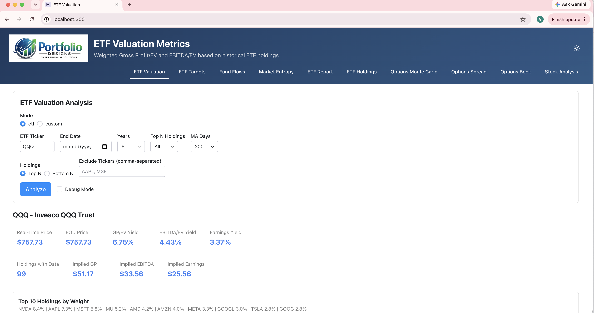

# Financial Analytics Dashboard

> A multi-page analytics suite: ETF valuation, fundamentals, options pricing,
> fund flows, and market-regime detection.

**Status:** closed-source product — this repo is a **showcase** (overview,
screenshots, methodology). · **Live demo:** available on request · **Site:**
[portfoliodesigns.io](https://portfoliodesigns.io)

<!-- Add a screenshot/GIF to screenshots/ and update the path below. -->


## What it is

A web application for multi-asset analysis that blends ETF-level valuation with
stock fundamentals, options pricing, and market-regime detection across a dozen
pages. Data flows from EOD Historical Data and a custom compute backend, with a
Redis caching layer and async fan-out across holdings for responsive deep dives.

## Highlights

- **ETF holdings valuation** — break an ETF into its holdings and compute GP/EV &
  EBITDA/EV yields, trend regression, percentile histograms, and distance-to-trend
  per holding, with historical as-of dates.
- **Fundamentals dashboard** — Income Statement / Balance Sheet / Cash Flow with
  custom time-series charting and analyst-estimate overlays.
- **Options Monte Carlo** — single-option Greeks and multi-leg book P&L
  distributions under volatility scenarios.
- **Options spread builder** for multi-leg strategies.
- **ETF price-target analysis** from dividend / earnings growth.
- **Fund-flows analysis** per ETF.
- **Market-entropy page** for regime detection.

## How it works

See **[docs/methodology.md](docs/methodology.md)** for the valuation and
analytics approach — EV yields, trend regression, percentile framing, and the
caching / fan-out architecture that makes multi-holding analysis responsive.

## Architecture

```
Reflex web UI  ──▶  FastAPI compute API  ──▶  EOD Historical Data
  (12+ pages,         (valuation, options,      (prices, fundamentals)
   tables, charts)     regressions)       └─▶  Redis cache + async fan-out
```

## Tech

`Reflex` · `FastAPI` · `EOD Historical Data` · `Redis` · `scikit-learn` · `Recharts`

## Disclaimer

This page describes a personal research project and is for educational and
illustrative purposes only. It is **not investment advice**, and nothing here is
an offer, solicitation, or recommendation to buy or sell any security. Any
figures, valuations, or analytics shown are illustrative, depend on model
assumptions and third-party data, and **do not predict future performance**.
Investing carries substantial risk of loss. Consult a qualified financial
professional before making investment decisions.

---

© Greg Harris · documentation and media only. Not open-source software.
